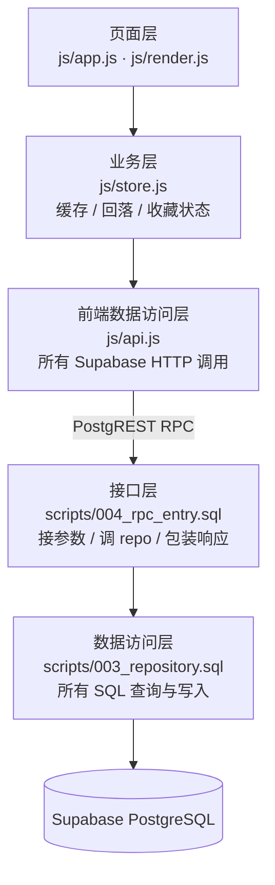

# 分层说明（Day 19 数据访问层拆分）

> 原则：接口只负责「接请求、返响应」，SQL 只出现在 repository；前端只负责「业务状态」，HTTP 只出现在 api.js。

## 分层图

## 每层放什么、不该出现什么

| 层 | 文件 | 职责 | 不该出现 |
|---|---|---|---|
| 页面层 | `js/app.js`、`js/render.js` | 事件、渲染、交互状态 | `fetch`、SQL |
| 业务层 | `js/store.js` | 缓存、回落、校验、收藏状态整理 | `fetch`、URL、请求头 |
| 前端数据访问层 | `js/api.js` | 所有 Supabase HTTP 调用、统一 `{ok,data,error}` | DOM、页面逻辑 |
| 接口层 | `scripts/004_rpc_entry.sql` | 接参数、调 repository、包装响应 | SQL 查询 / 写入 |
| 数据访问层 | `scripts/003_repository.sql` | 所有 SQL 查询 / 写入 | 响应包装、参数校验 |

## 重构前后对比

| | 重构前 | 重构后 |
|---|---|---|
| 后端 SQL | 直接写在 `get_songs` / `get_favorites` / `add_favorite` 里 | 全部收进 `003_repository.sql` 的 `repo_*` 函数 |
| 后端接口 | 自己写 SQL + 包装响应 | 只调 `repo_*` + 包装响应 |
| 前端 HTTP | `store.js` 里直接 `fetch` + 拼 URL/请求头 | 全部收进 `js/api.js`，`store.js` 只调 `Api.*` |
| 契约 | `{ok,data,error}` | **不变**（Day 19 禁止改契约） |

## 重构后回归结果（2026-10-20）

| 接口 | 结果 |
|---|---|
| `GET /api/songs` | 200，`{ok:true,data:[37 条],error:null}`，首条 `xiafeng` |
| `GET /api/favorites?uid=` | 200，`{ok:true,data:[...],error:null}` |
| `POST /api/favorites`（新 uid） | 200，`{ok:true,data:{uid,song_id},error:null}` |
| `POST /api/favorites`（重复） | 200，`{ok:false,data:{duplicate:true},error:"这首歌已经在收藏里了，不要重复添加"}` |
| `POST /api/favorites`（缺字段） | 200，`{ok:false,data:null,error:"缺少必填参数：uid、song_id"}` |

回归脚本：`scripts/regress-api.cjs`；前端逻辑回归用 Node 模拟 `localStorage` 跑 `store.js`（37 首 / 写入 / 读回均通过）。
